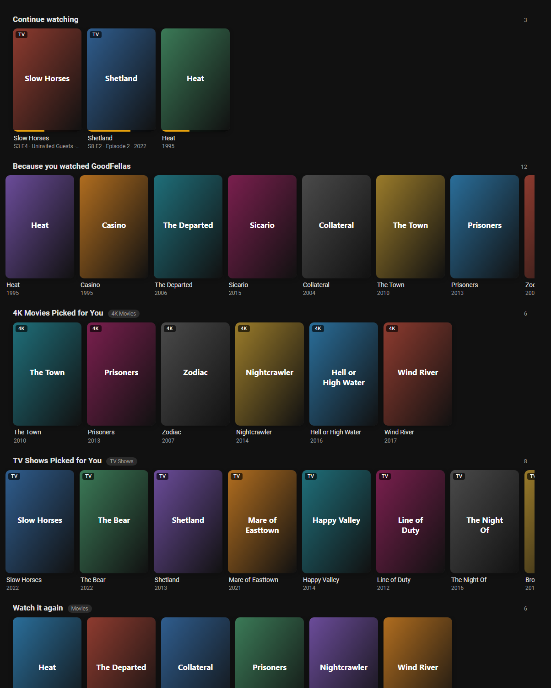

# Plex Picks

Netflix-style recommendation rows from your Plex server in Home Assistant, with a Play button for the TVs.

The recommendations themselves come from [Shortlist](https://github.com/stevezau/shortlist) (Steven Adams, MIT),
which reads each person's Plex watch history and writes private rows to Plex Home: Because you watched, Picked for
You, Watch it again, and more. Plex Picks reads those rows back out of Plex, adds the owner's Continue Watching and
what is new on the server, and shows them as poster rows on a dashboard, in the Companion app and on a wall tablet.
Tap a poster for the details and a Play button that sends the title to a TV through the core Plex integration.



## What you need

- A Plex Media Server and its owner token. Plex Web: open any title, Get Info, View XML, then copy the
  `X-Plex-Token` value from the address bar.
- Shortlist running against that server (the `addon/shortlist` folder here wraps it as a local Home Assistant add-on
  for Home Assistant OS; any Docker host works too). Without Shortlist you still get Continue Watching and New on the
  server.
- For the Play button: the core **Plex** integration set up in Home Assistant, so the Plex app on a TV (or a Cast
  device) is a media player it can drive.

## Install

1. HACS > Integrations > the three-dots menu > Custom repositories: add this repository as an Integration.
2. Download Plex Picks, restart Home Assistant.
3. Settings > Devices & services > Add integration > Plex Picks: the server URL and the token.
4. The integration's Configure button: pick the TVs for the Play button, and optionally Shortlist's URL and owner API
   token for a last-run sensor.

The card is served by the integration and registered as a dashboard resource; there is nothing else to install.

## The card

```yaml
type: custom:plex-picks-card
rows: [continue, because, picked, again, recent]   # which rows, by kind or row id; default every row
slug: themarkchristie                              # whose Shortlist rows; default everyone's
libraries: [Movies, TV Shows]                      # only rows for these libraries; default all
compact: false                                     # one row with smaller posters, for a Home dashboard section
max_items: 40                                      # per row
players: [media_player.living_room_tv]             # override the integration's Play targets
title: ""                                          # a heading above the rows
```

Row kinds: `continue` (the owner's Continue Watching), `because`, `picked`, `again`, `popular`, `seasonal`,
`requests`, `shortlist` (any other Shortlist row), `recent` (New on the server).

A dedicated **Watch** dashboard is one panel view holding the card alone (`dashboard/watch.yaml`). The same card in
compact mode sits in a Sections view on a Home dashboard (`dashboard/home-card.yaml`).

## Entities and services

- `sensor.plex_picks_<slug>`: how many titles Shortlist has in rows for that person, with one line per row.
- `sensor.plex_picks_continue_watching`, `sensor.plex_picks_recently_added`: counts, with the titles.
- `sensor.plex_picks_shortlist_last_run`: when Shortlist's URL and token are configured.
- `plex_picks.refresh`: read Plex again now. Plex is otherwise read every 30 minutes (configurable), and Shortlist's
  own webhook can point at a Home Assistant webhook automation that calls this.
- `plex_picks.play`: `rating_key`, `player`, `media_type`, `resume`. A Plex client or Cast device plays at once; a
  Samsung or Android TV is first told to open Plex, the Plex integration scans for clients, and the one that appears
  for that TV plays. Name the pairing in the options when a TV's Plex client should be fixed.

## Privacy

The Plex token stays on the Home Assistant server. Posters and backdrops are fetched server-side and handed to the
browser through signed, expiring URLs. The card reads its data over the Home Assistant websocket as the signed-in
user. Nothing is written to Plex.

## Development

```
python -m pytest tests -q        # the pure model
python tests/render_card.py      # headless screenshots of the card into tests/out
```

## Credits and licence

Recommendations by [Shortlist](https://github.com/stevezau/shortlist), MIT, Steven Adams. Plex Picks is MIT,
Mark Christie, 2026.
